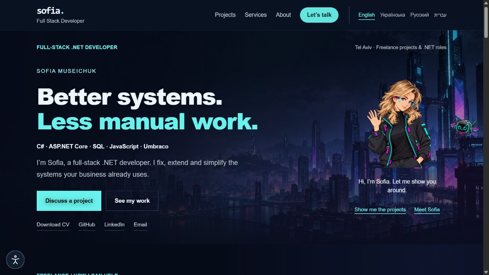

# Hi, I'm Sofia Museichuk

## Current status · 7 November 2026

**Portfolio:** [sofia-muse.github.io](https://sofia-muse.github.io/) (GitHub Pages). **Live Vercel projects:** [Mikhtav](https://mikhtav.vercel.app/), [Life RPG local-progress demo](https://life-rpg-opal-nine.vercel.app/) and [Coverdesk browser simulation](https://coverdesk.vercel.app/). All three Vercel production deployments were READY and their interfaces opened successfully. Demo screens do not establish backend production readiness.

Captures from 7 November 2026; existing portfolio captures are explicitly labeled above.

**Full-Stack .NET Developer based in Tel Aviv, Israel**

I build web applications with C#, ASP.NET, SQL Server and JavaScript. My commercial experience at eWave Online includes client dashboards, legacy SQL modernization, workflow automation, bilingual interfaces and external integrations.

I'm currently developing independent projects and looking for my next full-stack .NET role in Israel or a remote team open to Israel-based developers.

## Selected projects

- **[Insurance Management API](https://github.com/sofia-muse/insurance-management-system)** — ASP.NET Core 8, EF Core and SQL Server. Policy workflows with idempotent writes, audit events, business rules, and unit/integration tests.
- **[Mikhtav](https://github.com/sofia-muse/mikhtav)** — React/TypeScript frontend and .NET 8 API for a multilingual catalog explaining Israeli letters. Includes language fallback, RTL support and service/UI tests.
- **[Life RPG](https://github.com/sofia-muse/life-rpg)** — An ongoing React Native/Expo and .NET project exploring habit tracking, progression and offline synchronization. Still under development.

## Technologies

**Commercial experience:** C#, ASP.NET Core MVC / Web API, .NET Framework, EF Core / EF6, SQL Server, T-SQL, JavaScript, jQuery, Razor, Umbraco, Azure and Azure DevOps.

**Independent projects:** React, TypeScript, React Native, Expo, Zustand and i18next.

## Contact

[LinkedIn](https://www.linkedin.com/in/sofia-museichuk/) · [Email](mailto:sofia.museichuk@gmail.com)

English and Hebrew: fluent · Russian and Ukrainian: native
